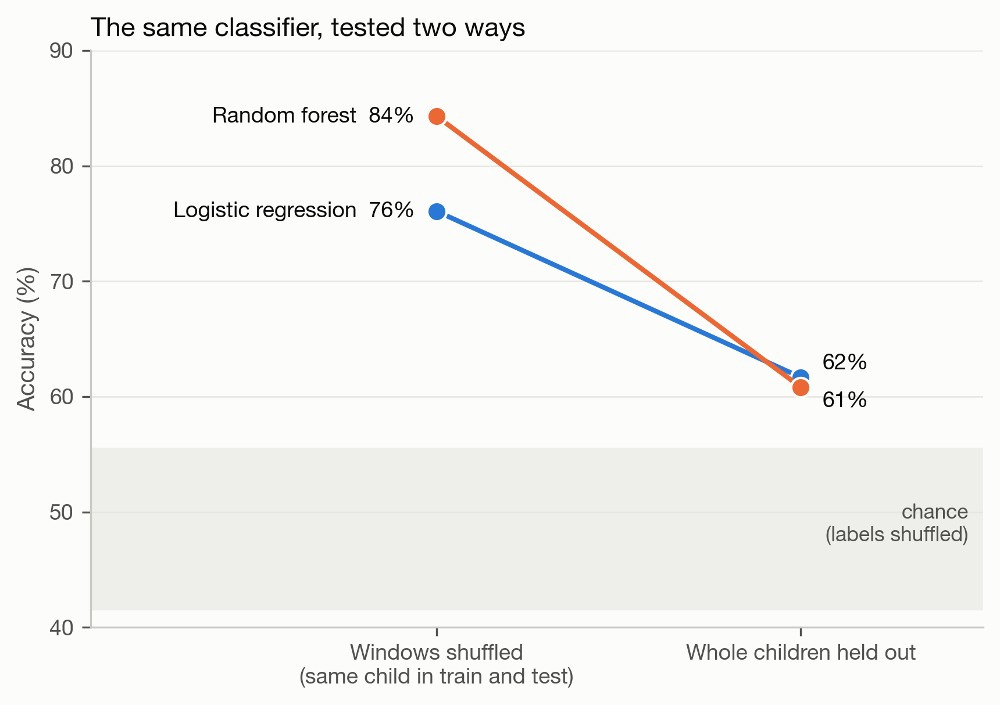

# ADHD EEG

Band-power analysis of a public EEG dataset: 61 children with ADHD and 60 controls, 19 channels, recorded during a visual attention task. An exercise on open data. It says nothing about any individual child and is no diagnostic tool.


## Classification depends on how you split

Each child gives about 30 four-second windows. Two ways to test a classifier on them:

| | Windows shuffled | Whole children held out |
|---|---|---|
| Random forest | 84% | 61% |
| Logistic regression | 76% | 62% |



With shuffled windows the same child is in training and test, and the model can score by recognising the child. Chance for the child-wise test, from 100 label shuffles, is 49% (95th percentile 54%); logistic regression at 62% is above it, p = 0.01.

## Group differences

One averaged value per child, n = 121.


Theta/beta ratio at Cz: ADHD median 2.13, controls 3.02 (Mann-Whitney p = 0.0006, d = −0.64). The usual claim is a higher ratio in ADHD; here it is lower. Beta power is higher in the ADHD group at 9 of 19 electrodes after FDR correction over 76 tests, and theta differs nowhere, so the ratio is driven by beta.


## Read before 

- The dataset description says the ADHD group had taken Ritalin for up to six months. Stimulants change the EEG.
- Beta and gamma are strongest at the edge electrodes, which is what muscle tension looks like. No ICA was run.
- Task recordings of varying length, where most theta/beta studies use resting EEG.
- One dataset from one site. Sampling rate taken as 128 Hz from the authors.

## Method

Per child: remove channel means, band-pass 1–45 Hz (zero-phase FIR), average reference, 4 s windows, drop windows whose peak-to-peak exceeds three times that child's median (97% kept). Welch spectra, band power as a share of 1–45 Hz power. Scalers are fitted on training children only.

## Running it

Get the data from [IEEE DataPort](https://ieee-dataport.org/open-access/eeg-data-adhd-control-children) and save it as `adhdata.csv` here (one row per sample, 19 electrode columns, `Class`, `ID`). It is not redistributed.

```bash
pip install -r requirements.txt
python3 features.py
python3 analysis.py     # figures + data/results.json
```

`legacy/` is the first version, an animated dashboard that compared a single child from each group.

MIT licence for the code.
