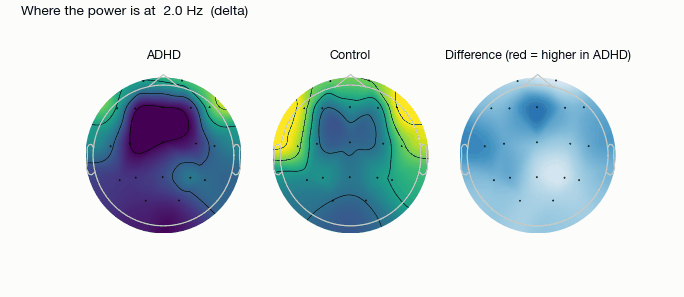
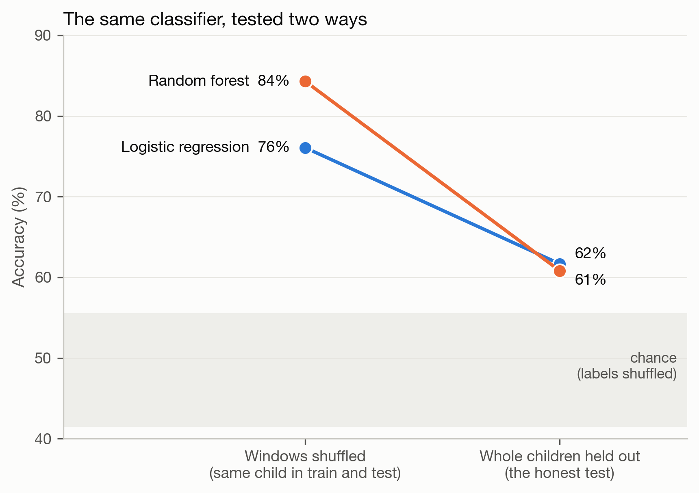
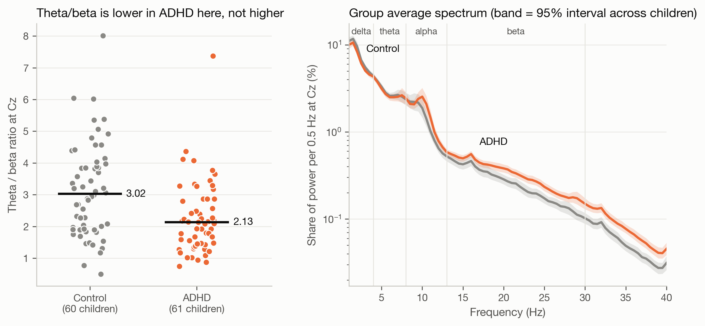
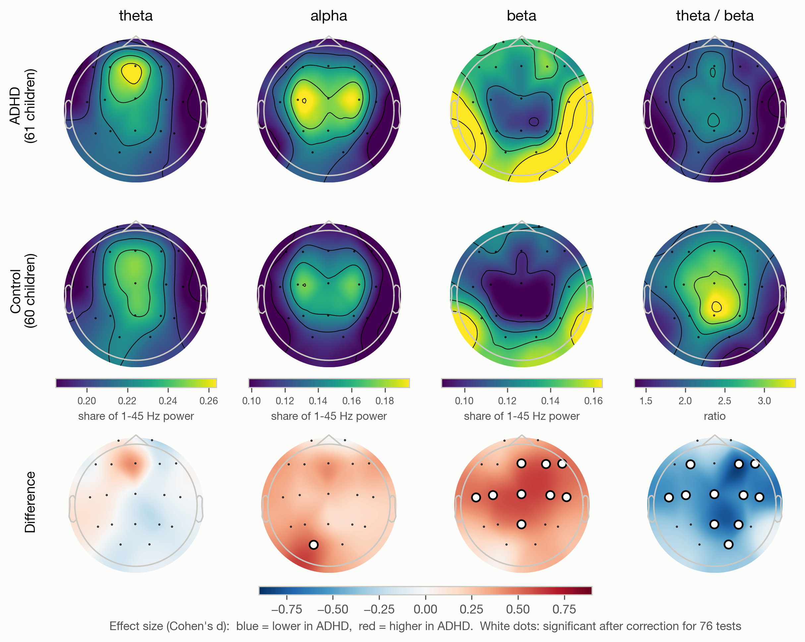

# ADHD from EEG: what survives an honest test

In 121 children, a classifier that scores **84%** when its test windows come from children it has already seen scores **61%** on children it has never seen. The theta/beta ratio, often described as raised in ADHD, is **lower** in the ADHD group in this dataset (2.13 against 3.02 at Cz, p = 0.0006).

This is an analysis exercise on a public dataset. It is not a diagnostic tool and makes no claim about any individual child.



## The honest test



Each child contributes about 30 four-second windows. If windows are shuffled before splitting, the same child ends up in both training and test data, and the model can score well by recognising the child and not the condition. Holding out whole children removes that shortcut.

| Classifier | Windows shuffled | Whole children held out |
|---|---|---|
| Random forest | 84% | 61% |
| Logistic regression | 76% | 62% |

Chance, measured by shuffling which child carries which label and repeating the child-wise test 100 times, is 49% (95th percentile 54%). The 62% is above chance (p = 0.01) and far below the number a shuffled split reports.

## Group differences





One averaged value per child, so the sample size is 121, not 4,058 windows.

- **Theta/beta ratio at Cz:** ADHD median 2.13, control 3.02, Cohen's d = −0.64. Used alone as a classifier it gives an AUC of 0.32, meaning it separates the groups in the opposite direction to the usual claim.
- **Beta power** is higher in the ADHD group at 9 of 19 electrodes after correction for multiple tests. Theta power does not differ at any electrode.
- So the lower ratio here comes from more beta, not less theta.

## Why it was done this way

- **The child is the unit.** Windows from one child are not independent measurements. Group statistics use one value per child, and cross-validation never splits a child.
- **Chance is measured, not assumed.** Shuffled-label accuracy is not exactly 50% with unequal window counts per child, so it is estimated from the data.
- **Relative power.** Each band is a share of that window's total 1–45 Hz power. Absolute amplitude depends on skull thickness and electrode contact, which differ between children.
- **Permutation tests with correction.** 76 electrode-by-measure tests are run, so p-values are corrected with the false discovery rate procedure.
- **Scaling inside the fold.** The standardiser is fitted on the training children only.

## Limitations

- **Medication.** The dataset description says the children with ADHD had taken Ritalin for up to six months. Stimulant medication can itself change the EEG, so the group difference cannot be attributed to ADHD alone.
- **Muscle activity.** Beta and gamma power are strongest at the edge electrodes, the pattern muscle tension produces. Children who move more would show more of it. No independent component analysis was run to remove it.
- **Task, not rest.** Recordings were made during a visual attention task, and recording length depended on each child's performance. Most theta/beta studies use resting EEG.
- **One dataset, one site.** 121 children; nothing here has been checked on a second cohort.
- Sampling rate is taken as 128 Hz, as stated by the dataset authors.

## Run it

Download the data from IEEE DataPort ("EEG data for ADHD / Control children", https://ieee-dataport.org/open-access/eeg-data-adhd-control-children) and place it as `adhdata.csv` in this folder: one row per sample, 19 electrode columns, then `Class` and `ID`. The data is not redistributed here.

```bash
pip install -r requirements.txt
```

```bash
python3 features.py
```

```bash
python3 analysis.py
```

`features.py` filters, re-references, cuts windows and rejects artefacts (97% of windows kept). `analysis.py` writes every figure and `data/results.json`, which holds every number quoted above. Together about five minutes.

`legacy/` holds the first version of this project, an animated dashboard comparing one child from each group. It is kept for the record; its single-pair comparison is the thing this version replaces.

## Licence

MIT (see `LICENSE`) for the code. The dataset belongs to its authors.

Renata Tukanova, 2026.
